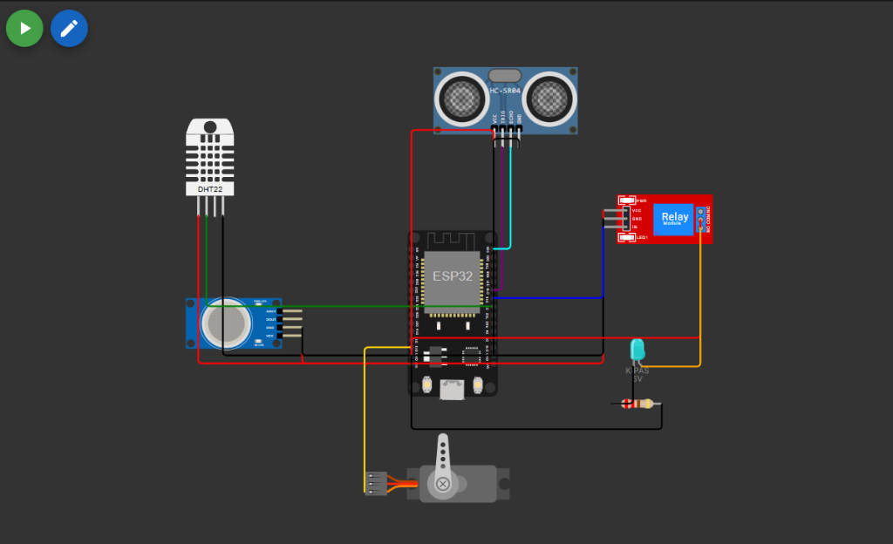

# Smart Barn Automation System (ESP32)

Sistem otomasi dan pemantauan lingkungan kandang ternak cerdas berbasis mikrokontroler ESP32 pada simulator Wokwi.

## Skematik Rangkaian Simulasi Wokwi (ESP32 + HC-SR04 + Servo + DHT22 + MQ-135 + Relay)

---

## Skema Pin dan Komponen

| Komponen | Pin Sensor/Aktuator | Pin ESP32 | Keterangan / Fungsi |
|---|---|---|---|
| Servo SG90 | PWM (Kuning) | GPIO 13 | Sistem Pemberi Makanan Otomatis (Katup pakan terbuka 90 derajat selama 3 detik) |
| | V+ (Merah) | VIN (5V) | Daya servo |
| | GND (Hitam) | GND | Ground |
| Ultrasonik HC-SR04 | TRIG (Ungu) | GPIO 19 | Membaca Kedalaman / Tinggi Air Minum Kandang |
| | ECHO (Cyan) | GPIO 23 | Menerima sinyal pantul ultrasonik |
| | VCC (Merah) | VIN (5V) | Daya sensor |
| | GND (Hitam) | GND | Ground |
| Sensor DHT22 | SDA (Hijau) | GPIO 5 | Suhu dan Kelembapan Ruang Kandang |
| Sensor Gas MQ-135 | A0 (Oranye) | GPIO 34 (ADC1) | Kualitas Udara dan Gas Amonia Kotoran |
| Modul Relay | IN (Biru) | GPIO 18 | Saklar Kipas Dinamo Exhaust / Pendingin Kandang |

---

## Cara Kerja Sensor dan Aktuator

### 1. Servo Motor (Pemberi Makanan Otomatis)
* Kondisi Standby: Posisi 0 derajat (Katup tertutup rapat agar makanan tidak tercecer).
* Beri Makanan:
  * Dipicu lewat perintah /feed atau /makan di Telegram, atau tombol "Beri Makanan" di Web Dashboard.
  * Servo berputar membuka katup ke 90 derajat selama 3 detik mengucurkan makanan ke wadah makan ternak, lalu secara non-blocking kembali menutup ke 0 derajat.

### 2. Sensor Ultrasonik (Tinggi / Kedalaman Air Minum)
* Sensor dipasang di atas tandon/wadah air minum ternak menghadap ke bawah.
* Perhitungan Kedalaman Air:
  Kedalaman Air (cm) = Tinggi Wadah (30 cm) - Jarak Sensor ke Air
  * Jika jarak sensor = 5 cm -> Kedalaman air = 25 cm (100% Penuh).
  * Jika jarak sensor = 17.5 cm -> Kedalaman air = 12.5 cm (50% Cukup).
  * Jika kedalaman air <= 6.0 cm (< 20%) -> Sistem membunyikan peringatan dan mengirim alert darurat ke Telegram: "Air Minum Kandang Hampir Habis!".

### 3. Kipas Exhaust / Pendingin (Modul Relay)
* Jika suhu kandang >= 30 derajat Celcius -> Kipas otomatis menyala (Mendinginkan Kandang).
* Jika suhu kandang <= 28 derajat Celcius -> Kipas otomatis mati (Suhu Sejuk Nyaman).
* Jika terdeteksi gas amonia pekat (>= 2400 ADC) -> Kipas otomatis menyala sebagai Exhaust sirkulasi udara.

---

## Cara Menguji di Simulator Wokwi
1. Buka folder systemKandangOtomatis di VS Code / Wokwi.
2. Tekan tombol Play untuk memulai simulasi.
3. Menguji Air Minum: Klik sensor HC-SR04 di layar Wokwi, geser slider jaraknya.
   * Geser ke 5 cm -> Air minum akan terbaca penuh (100%).
   * Geser ke 28 cm -> Air minum akan terbaca kritis (habis).
4. Menguji Pemberi Makanan: Klik tombol "Beri Makanan (Buka Servo 3s)" pada Web Dashboard atau kirim /feed di Telegram. Sayap servo akan berputar 90 derajat selama 3 detik lalu kembali ke 0 derajat.
